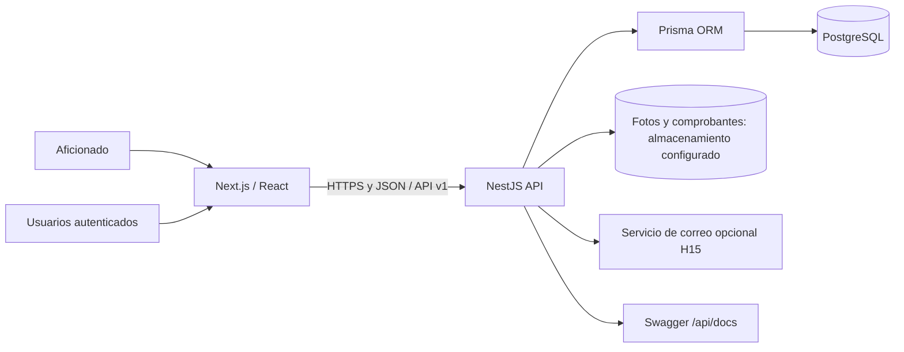

# Arquitectura

## Vista general



**Nota:** diagrama lógico, no acredita proveedor de hosting. La versión entregada deberá usar HTTPS y URLs públicas.

## Stack verificado en los manifests de `develop`

| Capa | Tecnología | Versión/dependencia |
|---|---|---|
| Frontend | Next.js / React / TypeScript | 16.3.6 / 19.2.8 / ^5 |
| Backend | NestJS / TypeScript | ^12.0.1 / ^6.0.2 |
| ORM | Prisma | ^7.10.0 |
| Datos | PostgreSQL | `postgres:18-alpine` para desarrollo local |
| Sesiones | JWT, refresh token y bcrypt | @nestjs/jwt ^12; bcrypt ^6 |
| Pruebas | Vitest y pruebas de UI | Backend ^4, frontend ^5 |
| Entorno local | Docker Compose | v2+ |

## Estructura

```text
backend/
  src/auth, users, inscripciones, calendario, posiciones
  src/estadisticas, cuotas, pagos, reportes, avisos, galeria
  prisma/schema.prisma; prisma/migrations; prisma/seed*.ts
  docs/ (documentos técnicos existentes)
  docker-compose.yml; Dockerfile; src/create-app.ts
frontend/
  app/ (rutas del App Router y server actions)
  components/; contexts/; lib/; hooks/
  docs/ (evidencia y diseño de historias)
  tests/; public/
```

## Decisiones técnicas

| Decisión | Justificación y alcance |
|---|---|
| Capitán derivado y un único rol persistido por usuario | La capitanía cambia por temporada; se comprueba contra el equipo, sin rol CAPITAN en `usuario` |
| Prisma y restricciones SQL adicionales | Integridad, unicidad y prevención de carreras en base de datos |
| Contexto de React para sesión | Estado global de usuario, rol y equipo sin biblioteca adicional |
| Polling en marcador y avisos | Requisitos temporales de H6 (10 s) y H19 (30 s), sin infraestructura WebSocket |
| Montos NUMERIC(12,2) | Evitar redondeos monetarios; contrato textual de cantidades |
| Servicio central de avisos | Los módulos envían mediante un contrato compartido, no directamente a la tabla |
| JWT y validación de roles en servidor | El frontend no otorga permisos; el backend decide identidad y pertenencia |

## Fuentes técnicas adicionales

Ver [modelo Prisma](https://github.com/CarlosCruz99/be_boilerplate_is_2026_nPCs/blob/develop/prisma/schema.prisma), [documentación técnica backend](https://github.com/CarlosCruz99/be_boilerplate_is_2026_nPCs/tree/develop/docs) y [documentación de frontend](https://github.com/CarlosCruz99/fe_boilerplate_is_2026_nPCs/tree/develop/docs).


## Localización de la documentación técnica original

La consolidación no reemplaza el detalle de diseño de las tareas del backend: en `develop/docs/` ya existen, entre otros, `er-h1.md`, `er-h3.md`, `er-h5.md`, `er-h6.md`, `er-h7.md`, `er-h8.md`, `er-h9.md`, `er-h12.md`, `er-h13.md`, `er-h15.md`, `er-h17.md`, `er-h20.md`, `er-h21.md`, `er-h23.md`, `er-h24.md`, `contrato-avisos.md` y documentos de seed. La carpeta `docs/` de la entrega debe **conservar también esos archivos**, además de incorporar las nueve páginas generales.

En el frontend permanecen los diseños de tareas y las evidencias de `docs/evidence/`. No sustituir las rutas técnicas por las páginas resumidas: las primeras documentan decisiones y pruebas por historia, mientras que `docs/01` a `09` ofrecen la lectura consolidada exigida por la cátedra.

## Riesgo técnico del almacenamiento

En el entorno local el backend utiliza un volumen para `uploads` y PostgreSQL tiene su volumen `pgdata`. Cuando la API se despliega en un proveedor con disco efímero, se debe verificar que las fotografías, comprobantes y archivos de galería conserven su persistencia y sus controles de acceso. El paquete no presupone un proveedor de almacenamiento externo que no esté confirmado en el código.

## Actualización H5: consulta operativa de mesa (PR #31)

`CalendarioModule` registra `MesaPartidoController` y `MesaPartidoService`. `GET /api/v1/partidos/:partidoId/mesa` consulta mediante Prisma el partido y las participaciones; la transacción `RepeatableRead` entrega un estado consistente de equipos, marcador, faltas, tiempos reales y participantes. El guard `@ArbitroAsignado()` valida que el usuario autenticado sea el árbitro asignado, incluso después de una sustitución. Los DTO agregan las anotaciones OpenAPI y los encabezados de respuesta impiden cachear información privada. Esta ruta de **lectura** reutiliza los modelos existentes y no requiere migración de base de datos. Véase [API](04-api.md) y [PR #31](https://github.com/CarlosCruz99/be_boilerplate_is_2026_nPCs/pull/31).
