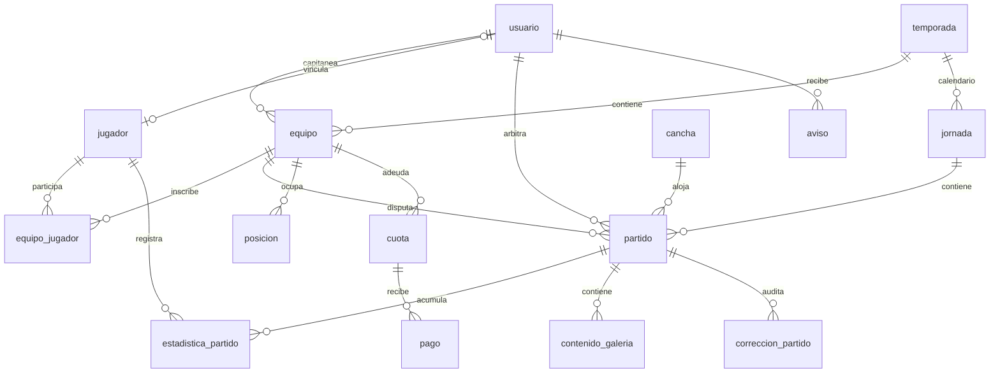

# Modelo de datos

Modelo consolidado de `prisma/schema.prisma` en `main`; nombres SQL del proyecto. Diagrama resumido: las relaciones opcionales y tablas de auditoría se explican debajo.

## Entidades principales

| Tabla | Propósito / campos relevantes |
|---|---|
| `usuario` | UUID, email, password_hash, rol, nombre, fecha_nacimiento, is_active |
| `refresh_tokens` | Hash del refresh token, usuario, expiración y revocación |
| `temporada` | Nombre, fechas, actual, inscripcion_abierta, max_equipos |
| `equipo` | Temporada, capitán, estado, fecha de validación, validador y motivo de rechazo |
| `jugador` | Nombre, identificación, nacimiento, foto_url y vínculo opcional a usuario |
| `equipo_jugador` | Relación equipo-jugador-temporada con restricción de inscripción única |
| `cancha` | Nombre, dirección, indicador activa |
| `jornada` | Número, temporada, BORRADOR/PUBLICADA y datos de publicación |
| `partido` | Equipos, cancha, árbitro, horarios, estado, marcador, faltas, inicio/fin reales |
| `bitacora_marcador` | Auditoría de inicio, actualizaciones y finalización |
| `participacion_partido` | Jugadores participantes del partido |
| `estadistica_partido` | Goles, asistencias y tarjetas por jugador y partido |
| `posicion` | PJ, PG, PE, PP, GF, GC, DG y puntos por equipo/temporada |
| `cuota` | Concepto INSCRIPCION/ARBITRAJE, equipo, monto, vencimiento y partido opcional |
| `pago` | Cuota, monto, comprobante privado, estado, idempotencia y decisión |
| `aviso` | Destinatario, módulo, tipo, título, mensaje, leído y referencia |
| `cambio_partido`, `entrega_correo` | Auditoría de cambios y entrega de avisos externos |
| `contenido_galeria` | Referencia de medios, partido, subidor y metadatos |
| `correccion_partido` | Auditoría de correcciones oficiales de resultados |

## Reglas de integridad esenciales

- Los equipos pasan por PENDIENTE, INSCRITO o RECHAZADO; los partidos por PROGRAMADO, EN_CURSO, FINALIZADO o CANCELADO.
- Una cuenta capitanea como máximo un equipo en cada temporada; un jugador solo puede estar en un equipo por temporada.
- `posicion` se deriva de resultados FINALIZADO, sin edición manual.
- Los pagos PENDIENTE reservan disponible pero no reducen saldo; solo VERIFICADO reduce saldo.
- Montos con `Decimal(12,2)` y archivos de comprobantes privados.
- Las restricciones de colisiones, unicidad funcional e índices adicionales deben consultarse en [migraciones](https://github.com/CarlosCruz99/be_boilerplate_is_2026_nPCs/tree/main/prisma/migrations), además del modelo ORM.
