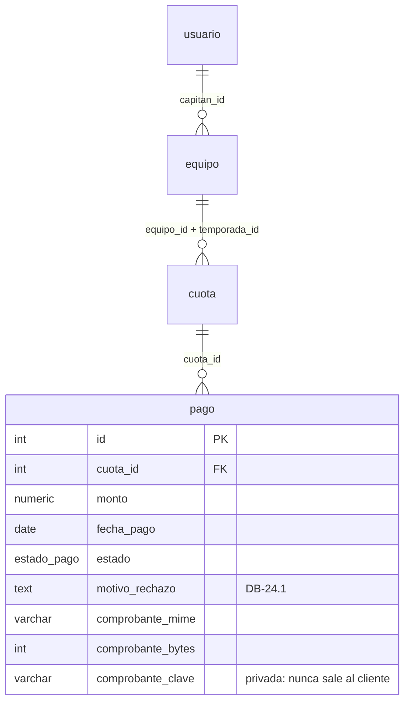

# H14 · Consultas del historial de pagos de un equipo (DB-14.1)

Migración: `20261113100000_db_14_1_indice_cuota_equipo` (depende de DB-12.1, DB-13.1, DB-24.1 y DB-1.1)

No se crean tablas ni archivos paralelos: se reutilizan `pago`, `cuota` y `equipo`. La capitanía es `equipo.capitan_id` (UUID de `usuario.id`) y el comprobante vive en las columnas `comprobante_*` de `pago` (almacenamiento privado de DB-13.1).



## Índice agregado

`ix_cuota_equipo_temporada` sobre `cuota (equipo_id, temporada_id)`. `cuota` solo tenía dos índices únicos **parciales** (uno por concepto), que no sirven para "todas las cuotas del equipo en la temporada". Los pagos de cada cuota ya se alcanzan por `ix_pago_cuota_estado (cuota_id, estado)` (DB-13.1). No se altera ningún dato de H12/H13.

## Consultas (para `$queryRaw`)

**1. Autorización** (`$1` equipo, `$2` temporada, `$3` id de la sesión). Sin filas = el equipo no existe en esa temporada (404). `false` = no es su capitán o su rol persistido no es JUGADOR (403).

```sql
SELECT COALESCE(e.capitan_id = u.id AND u.rol = 'JUGADOR', false) AS autorizado
FROM equipo e
LEFT JOIN usuario u ON u.id = $3::uuid
WHERE e.id = $1 AND e.temporada_id = $2;
```

**2. Lista** (`$1` equipo, `$2` temporada, `$3` concepto o NULL). Todos los pagos filtrados, sin paginar. Los metadatos del comprobante salen de la misma fila de `pago`, así que no hay unión que duplique filas, y **`comprobante_clave` no se selecciona**.

```sql
SELECT p.id, p.cuota_id, c.concepto, p.monto, p.fecha_pago, p.estado, p.motivo_rechazo,
       p.comprobante_mime, p.comprobante_bytes
FROM pago p
JOIN cuota c ON c.id = p.cuota_id
WHERE c.equipo_id = $1 AND c.temporada_id = $2
  AND ($3::concepto_cuota IS NULL OR c.concepto = $3::concepto_cuota)
ORDER BY p.fecha_pago DESC, p.id DESC;
```

**3. Totales** (mismos parámetros). Siempre una fila; sin pagos devuelve cuatro ceros. Usa exactamente el mismo `FROM` y `WHERE` que la lista.

```sql
SELECT COALESCE(SUM(p.monto), 0)                                          AS total_registrado,
       COALESCE(SUM(p.monto) FILTER (WHERE p.estado = 'VERIFICADO'), 0)   AS total_verificado,
       COALESCE(SUM(p.monto) FILTER (WHERE p.estado = 'PENDIENTE'), 0)    AS pendiente_verificacion,
       COALESCE(SUM(p.monto) FILTER (WHERE p.estado = 'RECHAZADO'), 0)    AS total_rechazado
FROM pago p
JOIN cuota c ON c.id = p.cuota_id
WHERE c.equipo_id = $1 AND c.temporada_id = $2
  AND ($3::concepto_cuota IS NULL OR c.concepto = $3::concepto_cuota);
```

Para que lista y totales vean el mismo conjunto, el backend puede ejecutarlas en una sola transacción (`prisma.$transaction([...])`).

## Reglas monetarias

- **El dinero confirmado es solo `total_verificado`** (H13/H21). Pendientes y rechazados **no** lo aumentan: con el conjunto de prueba (100.00 verificado, 25.50 pendiente, 10.00 rechazado) los totales son 135.50 / 100.00 / 25.50 / 10.00.
- El historial **no modifica** saldo ni disponible: `saldo = cuota.monto − verificado` y `disponible = cuota.monto − verificado − pendiente` siguen a cargo de `fn_saldo_cuota` (DB-13.1).
- El motivo de un rechazo es `pago.motivo_rechazo` (DB-24.1).

## EXPLAIN

En una copia temporal de 60 mil cuotas con el mismo índice:

```
Bitmap Heap Scan on cuota_escala (actual rows=20 loops=1)
  ->  Bitmap Index Scan on ix_escala_cuota (actual rows=20 loops=1)
        Index Cond: ((equipo_id = 5) AND (temporada_id = 5))
```

## Reversión

`down.sql` elimina el índice.
