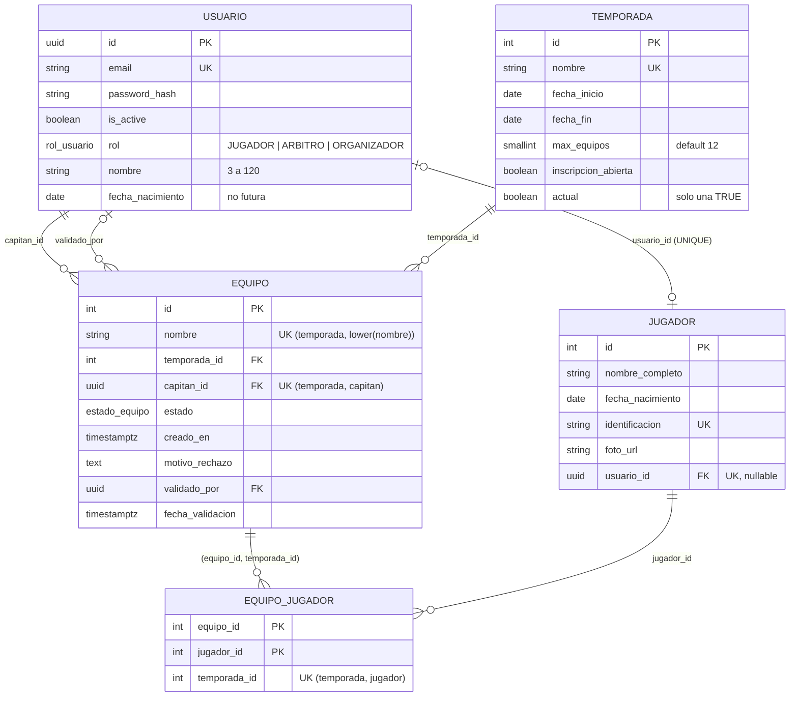

# Diagrama ER · H1 (inscripción) y DB-2.1

Reglas clave:
- `UNIQUE (temporada_id, jugador_id)`: un jugador, un equipo por temporada.
- FK compuesta `(equipo_id, temporada_id)`: la temporada del vínculo es la del equipo.
- Capitán = `equipo.capitan_id` (no es un rol almacenado).
