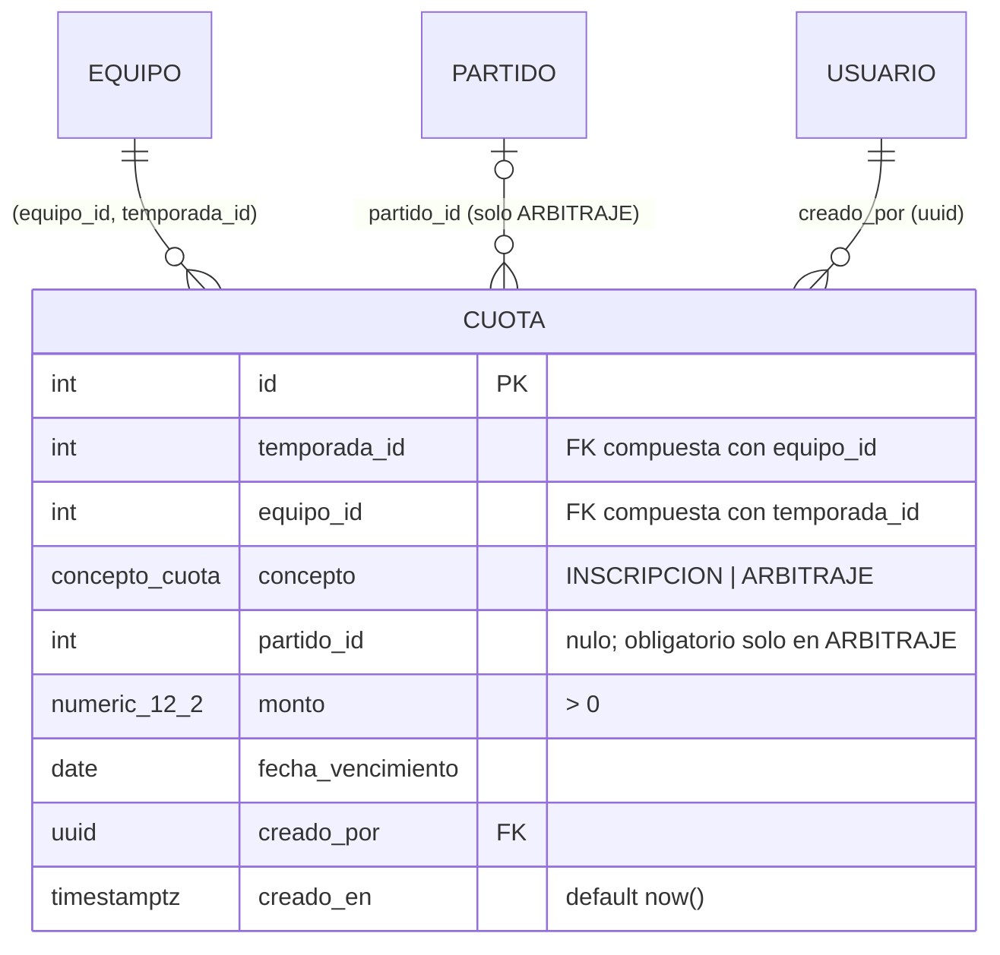

# ER · H12 (cuota)

## Restricciones

| Regla | Mecanismo | Error |
|---|---|---|
| Monto mayor que cero | `CHECK (monto > 0)` | 23514 |
| Monto dentro de NUMERIC(12,2) | tipo de la columna | 22003 |
| Inscripción sin partido; arbitraje con partido | `ck_cuota_partido` | 23514 |
| Una inscripción por equipo y temporada | índice único parcial `uq_cuota_inscripcion (temporada_id, equipo_id) WHERE concepto = 'INSCRIPCION'` | 23505 |
| Un arbitraje por equipo y partido | índice único parcial `uq_cuota_arbitraje (partido_id, equipo_id) WHERE concepto = 'ARBITRAJE'` | 23505 |
| El equipo existe y pertenece a esa temporada | FK compuesta `(equipo_id, temporada_id)` a `equipo(id, temporada_id)` | 23503 |
| Partido y creador existentes | FK `RESTRICT` | 23503 |
| No se borra un equipo ni un partido con cuotas | FK `RESTRICT` | 23503 / 23001 |

**Concurrencia:** los índices únicos parciales hacen que, si dos solicitudes crean la misma cuota a la vez, la segunda espere a la primera y falle con 23505 (BE-12.1 lo responde como 409). Se comprobó con dos sesiones simultáneas: queda una sola fila.

## Lo que la base NO valida (lo hace BE-12.1)

- **Más de dos decimales:** `NUMERIC(12,2)` redondea en silencio (`10.005` se guarda como `10.01`). BE-12.1 debe rechazarlo antes de guardar; la prueba `db-h12-restricciones.sql` lo deja documentado.
- **Que el equipo esté inscrito**, **que juegue el partido** y que el partido sea de la misma temporada (422).
- **Monto máximo de 100,000.00** y **fecha de vencimiento no anterior a hoy** en America/El_Salvador (400).
