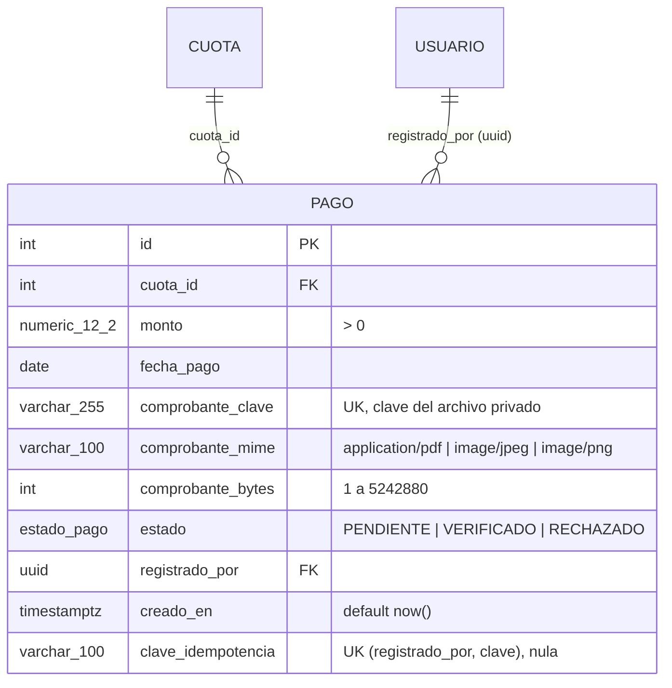

# ER y saldos · H13 (pago)



La tabla guarda solo **metadatos** del comprobante. El archivo va a almacenamiento privado, con la clave generada en `comprobante_clave`. La revisión de H24 (quién verificó o rechazó y cuándo) se agrega en DB-24.1.

## Saldos: `fn_saldo_cuota`

Los saldos **no se guardan**; se calculan siempre desde los pagos:

| Campo | Regla |
|---|---|
| `total_verificado` (V) | suma de pagos VERIFICADO |
| `pendiente_verificacion` (P) | suma de pagos PENDIENTE |
| `saldo` | `monto_total − V` |
| `disponible` | `monto_total − V − P` |

RECHAZADO no aporta a V ni a P. Los nombres de las columnas coinciden con la respuesta de `GET /equipos/{id}/cuotas` de BE-13.1 (`monto_total`, `total_verificado`, `saldo`, `pendiente_verificacion`, `disponible`).

```sql
SELECT * FROM fn_saldo_cuota(:cuotaId);   -- una cuota
SELECT c.equipo_id, c.concepto, s.*       -- todas las cuotas de un equipo
FROM cuota c JOIN fn_saldo_cuota() s ON s.cuota_id = c.id
WHERE c.equipo_id = :equipoId AND c.temporada_id = :temporadaId;
```

Se usa una función y no una vista porque Prisma ignora las funciones al revisar deriva (ya lo hace con los triggers del proyecto) y no pude confirmar lo mismo para las vistas.

## Restricciones

| Regla | Mecanismo | Error |
|---|---|---|
| Monto mayor que cero | `CHECK` | 23514 |
| PDF, JPEG o PNG; de 1 byte a 5 MiB | `CHECK` en `comprobante_mime` y `comprobante_bytes` | 23514 |
| Un archivo pertenece a un solo pago | `UNIQUE (comprobante_clave)` | 23505 |
| Idempotencia por usuario | `UNIQUE (registrado_por, clave_idempotencia)` (los NULL no chocan) | 23505 |
| Cada pago referencia una cuota y un usuario existentes | FK `RESTRICT` | 23503 |
| No se borra una cuota con pagos | FK `RESTRICT` | 23503 / 23001 |
| PENDIENTE + VERIFICADO no superan el monto de la cuota | trigger `tr_pago_no_supera_cuota` | 23514 |

## Reserva del disponible y concurrencia

El trigger bloquea la fila de la cuota (`FOR UPDATE`) antes de sumar. Dos pagos simultáneos que caben por separado pero no juntos se turnan: el segundo espera, ve al primero y falla con 23514 (BE-13.1 lo responde como 409). Se comprobó con dos sesiones a la vez sobre una cuota de 100.00 y dos pagos de 60.00: queda un solo pago y el disponible es 40.00.

Es el mismo bloqueo que pide el documento: BE-13.1 y las transiciones de H24 pueden hacer `SELECT … FOR UPDATE` sobre la cuota en su transacción, y el trigger lo reutiliza sin bloquearse a sí mismo.

## Decisiones que van más allá del texto de la tarea

- **Trigger del disponible.** Sin él, la regla "no superar el disponible" dependería solo de que todo el código recuerde bloquear y comprobar. Si se prefiere dejarla solo al backend, basta quitar el bloque.
- **CHECK de formato y tamaño** (`ck_pago_comprobante_*`), tomados del contrato de BE-13.1.
- **`UNIQUE (comprobante_clave)`**: evita que borrar un archivo huérfano afecte a otro pago.
- **`ix_pago_cuota_estado`**: acelera las sumas por cuota y estado.
- **`clave_idempotencia` admite NULL**: el documento no dice si es obligatoria; si BE-13.1 la exige siempre, se puede declarar NOT NULL.

## Lo que la base NO valida (lo hace BE-13.1)

Que la fecha de pago no sea futura en America/El Salvador, el máximo de dos decimales (`NUMERIC(12,2)` redondea en silencio), que el pago sea de un capitán del equipo y la verificación del contenido del archivo.
