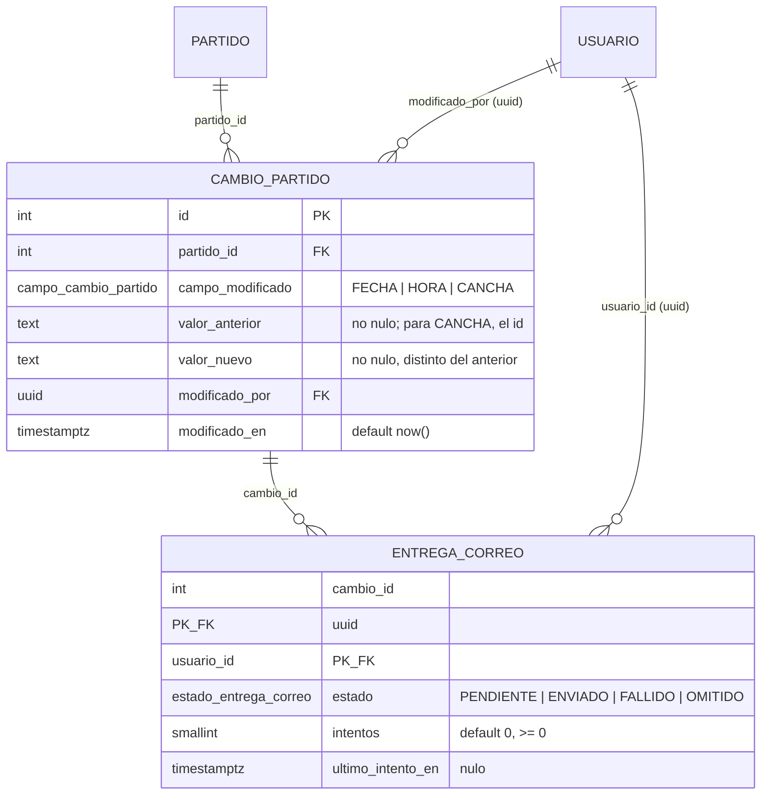

# ER · H15 (cambio_partido y entrega_correo)



El **aviso interno** no se guarda aquí: lo guarda H20 (`aviso`, con la clave `partido-{id}-cambio-{cambioId}`). Estas tablas conservan el cambio y el estado de la entrega del **correo**; no se duplica la tabla de avisos.

## Restricciones

| Regla | Mecanismo | Error |
|---|---|---|
| Solo fecha, hora y cancha generan evento | enum `campo_cambio_partido` | 22P02 |
| No hay evento si el valor nuevo es igual al anterior | `CHECK (valor_nuevo <> valor_anterior)` | 23514 |
| Para cancha se guarda el id, no el nombre | `CHECK` con `^[0-9]+$` para `CANCHA` | 23514 |
| Valores anterior y nuevo obligatorios | `NOT NULL` | 23502 |
| Partido y usuario existentes | FK `RESTRICT` | 23503 |
| Una entrega por cambio y destinatario | `PRIMARY KEY (cambio_id, usuario_id)` (equivale al `UNIQUE` del documento) | 23505 |
| Intentos no negativos | `CHECK` | 23514 |
| No se borra un cambio con entregas ni un partido con cambios | FK `RESTRICT` | 23503 / 23001 |

## Índices

| Índice | Uso |
|---|---|
| `ix_cambio_partido_partido_fecha (partido_id, modificado_en)` | historial de cambios de un partido, en orden |
| `ix_entrega_correo_estado (estado)` | cola de correos pendientes y fallidos por reintentar |

## Consultas

```sql
-- Un cambio con quién lo hizo, y el nombre de la cancha cuando el campo es CANCHA
SELECT c.id, c.campo_modificado, c.valor_anterior, c.valor_nuevo, u.nombre AS modificado_por, c.modificado_en
FROM cambio_partido c JOIN usuario u ON u.id = c.modificado_por
WHERE c.partido_id = :partidoId ORDER BY c.modificado_en;

SELECT ca.nombre FROM cambio_partido c JOIN cancha ca ON ca.id = c.valor_nuevo::int
WHERE c.id = :cambioId AND c.campo_modificado = 'CANCHA';

-- Correos por reintentar
SELECT * FROM entrega_correo WHERE estado IN ('PENDIENTE', 'FALLIDO');
```

## Cómo cumple los criterios

- **Una falla de correo no elimina el evento ni el aviso interno:** `entrega_correo` es una tabla aparte; marcar una entrega como `FALLIDO` solo cambia esa fila, y el cambio no se puede borrar mientras tenga entregas. El aviso interno vive en `aviso`, que estas tablas no referencian.
- **La migración se revierte sin borrar datos de partidos:** `down.sql` elimina solo `entrega_correo`, `cambio_partido` y sus tipos. Se comprobó con 66 partidos y 47 avisos antes y después.

## Decisión que va más allá del texto de la tarea

`ck_cambio_cancha_id` obliga a que, para la cancha, los dos valores sean ids numéricos (el documento dice "se guarda el id"). Si BE-3.1 prefiere guardar otra cosa, se quita en una línea. Los valores de `FECHA` y `HORA` no tienen formato forzado: BE-3.1 decide cómo escribirlos (por ejemplo `2026-11-08` y `09:30`).
