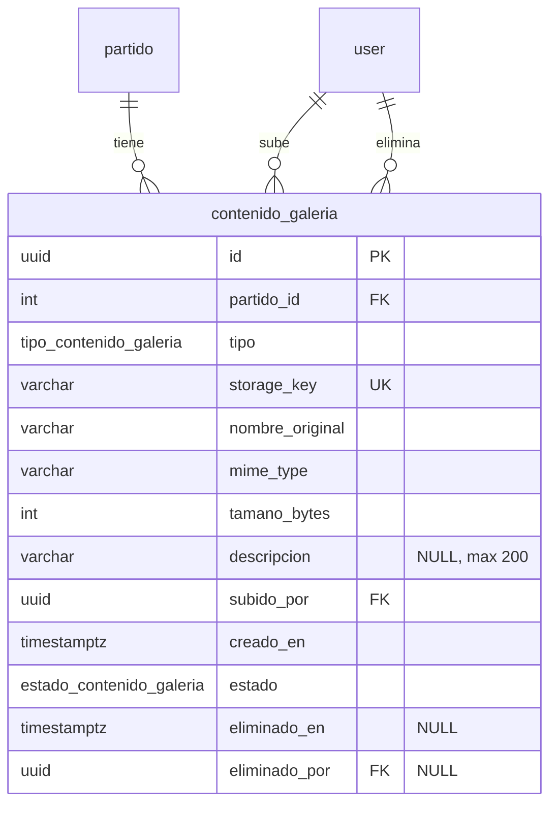

# H17 · Galería de fotos y videos por partido (DB-17.1)

Migración: `20261111160000_db_17_1_contenido_galeria`

## Estrategia de almacenamiento (decisión: local privado)

- El archivo **no** se guarda en la BD. Vive en un directorio privado del servidor (fuera de `public/`, no servido como estático).
- La BD guarda solo metadatos y `storage_key`: una clave relativa aleatoria (por ejemplo `galeria/<uuid>.jpg`). Nunca se guarda una ruta absoluta ni el nombre original como nombre en disco.
- Descarga: endpoint autenticado que hace streaming leyendo `storage_key`.
- Subida: 1) guardar archivo, 2) insertar metadatos. Si el INSERT falla (p. ej. límite de 30), el backend borra el archivo.
- Borrado: primero lógico (`estado = ELIMINADO`, `eliminado_en`, `eliminado_por`); el borrado físico es posterior.
- Las filas del seed **no tienen archivo físico**; el frontend/BE debe tolerar archivo ausente.

## ER

## Diccionario de datos

| Columna | Tipo | Nulo | Regla |
|---|---|---|---|
| id | UUID | no | PK (lo genera Prisma, sin default en BD) |
| partido_id | INT | no | FK partido, ON DELETE RESTRICT |
| tipo | enum FOTO/VIDEO | no | |
| storage_key | VARCHAR(255) | no | UNIQUE |
| nombre_original | VARCHAR | no | no vacío |
| mime_type | VARCHAR | no | FOTO: image/jpeg, image/png · VIDEO: video/mp4 |
| tamano_bytes | INT | no | FOTO 1..5 242 880 (5 MiB) · VIDEO 1..52 428 800 (50 MiB) |
| descripcion | VARCHAR(200) | sí | máx. 200 |
| subido_por | UUID | no | FK usuario, RESTRICT |
| creado_en | TIMESTAMPTZ(3) | no | default now() |
| estado | enum ACTIVO/ELIMINADO | no | default ACTIVO |
| eliminado_en / eliminado_por | TIMESTAMPTZ / UUID | sí | ACTIVO ⇒ ambos NULL; ELIMINADO ⇒ ambos con valor |

## Índices

- `contenido_galeria_storage_key_key` (único).
- `ix_galeria_partido_fecha (partido_id, creado_en DESC, id DESC)`: paginación estable por partido, con `id` como desempate.
- `ix_galeria_activos (partido_id) WHERE estado='ACTIVO'`: parcial, para el conteo del límite y el listado.

## Qué valida la BD y qué no

La BD garantiza: límite de 30 activos por partido (trigger, seguro bajo concurrencia porque bloquea la fila del partido con `FOR NO KEY UPDATE`), coherencia tipo/mime/tamaño, longitud de descripción, consistencia del borrado lógico y unicidad de la clave.

La BD **no** puede validar: que el contenido real del archivo sea del tipo declarado (firma/magic bytes), que el archivo exista en disco, ni que el usuario tenga rol ORGANIZADOR. Eso es responsabilidad del backend.

Los elementos ELIMINADOS no cuentan para el límite: al borrar uno se libera un cupo.

## Añadidos más allá de la especificación (se pueden quitar)

1. Trigger `tr_galeria_limite_activos` para el límite de 30.
2. CHECK de mime y de tamaño por tipo.
3. Columnas de borrado lógico `eliminado_en` / `eliminado_por`.
4. UNIQUE en `storage_key`.

## Seed

`prisma/seed-galeria.ts` (idempotente, upsert por `storage_key`): los 3 primeros partidos de Apertura 2026 por id → 30, 1 y 0 elementos. El partido de 30 tiene 25 fotos y 5 videos, y una descripción de exactamente 200 caracteres. Hay fechas repetidas a propósito para probar el desempate de la paginación.

## Reversión

`down.sql` elimina trigger, función, tabla y enums. Los archivos físicos que existieran quedarían huérfanos en el disco.
