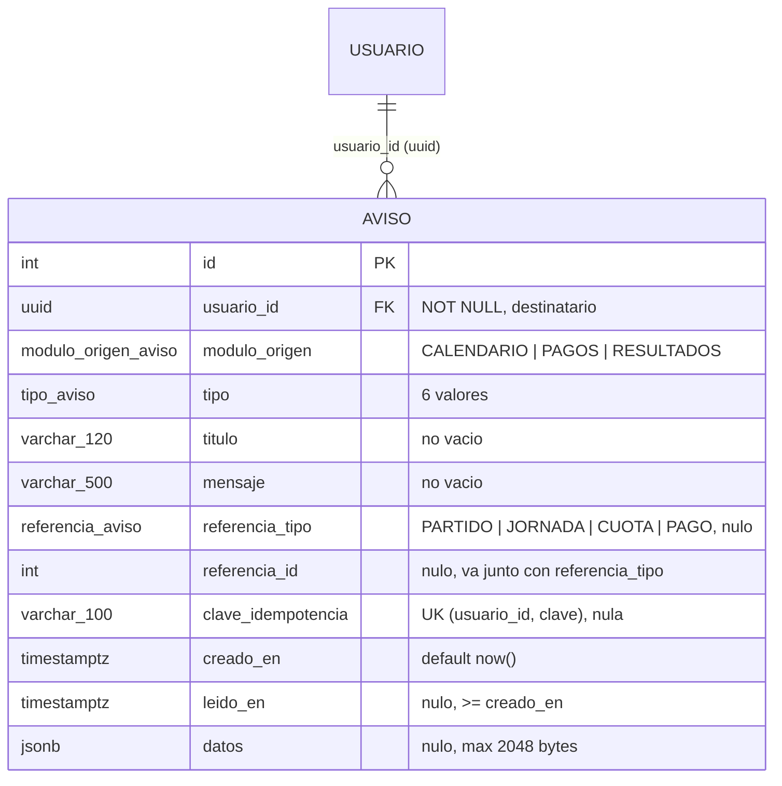

# Diagrama ER · H20 (tabla aviso)

`referencia_id` no es una llave foránea: apunta a una tabla distinta según `referencia_tipo` (partido, jornada, cuota o pago), y esas tablas pertenecen a módulos distintos.

## Restricciones

| Regla | Mecanismo | Error |
|---|---|---|
| Título y mensaje no vacíos ni de solo espacios | `CHECK (char_length(btrim(...)) > 0)` | 23514 |
| Título máx. 120 y mensaje máx. 500 caracteres | `VARCHAR(120)` y `VARCHAR(500)` | 22001 |
| Módulo, tipo y tipo de referencia dentro de la lista | tipos `ENUM` | 22P02 |
| Referencia completa o ausente | `CHECK ((referencia_tipo IS NULL) = (referencia_id IS NULL))` | 23514 |
| Un aviso por usuario y clave | `UNIQUE (usuario_id, clave_idempotencia)` (los NULL no chocan) | 23505 |
| Solo usuarios existentes; no se borra un usuario con avisos | FK `ON DELETE RESTRICT` | 23503 |
| `leido_en` no anterior a `creado_en` | `CHECK` | 23514 |
| `datos` de 2048 bytes o menos | `CHECK (octet_length(datos::text) <= 2048)` | 23514 |

## Índices

| Índice | Uso |
|---|---|
| `ix_aviso_usuario_fecha (usuario_id, creado_en DESC)` | bandeja de H19: avisos del usuario, los más recientes primero |
| `ix_aviso_no_leidos (usuario_id) WHERE leido_en IS NULL` | contador de no leídos; solo contiene filas pendientes |
| `aviso_usuario_id_clave_idempotencia_key` | idempotencia; también sirve para buscar un aviso por usuario y clave |

## Claves de idempotencia del contrato (H20)

| Evento | Clave |
|---|---|
| H16 · jornada publicada | `jornada-{id}-capitan-{usuarioId}` |
| H15 · cambio de partido | `partido-{id}-cambio-{cambioId}` |
| H13 · pago registrado | `pago-{id}` |
| H5 · partido finalizado | `partido-{id}-finalizado` |

Con esto DB-16.1 queda cubierta: republicar una jornada repite la clave y la base rechaza el segundo aviso.

## Lo que la base NO valida

- Que el **tipo corresponda a su módulo** (por ejemplo `JORNADA_PUBLICADA` con `CALENDARIO`): lo rechaza el servicio de BE-20.1, como indica el contrato.
- Que la **referencia exista** (no hay FK, ver arriba).
- Que solo el servicio escriba en la tabla: se controla con la regla de lint o prueba de BE-20.1.
