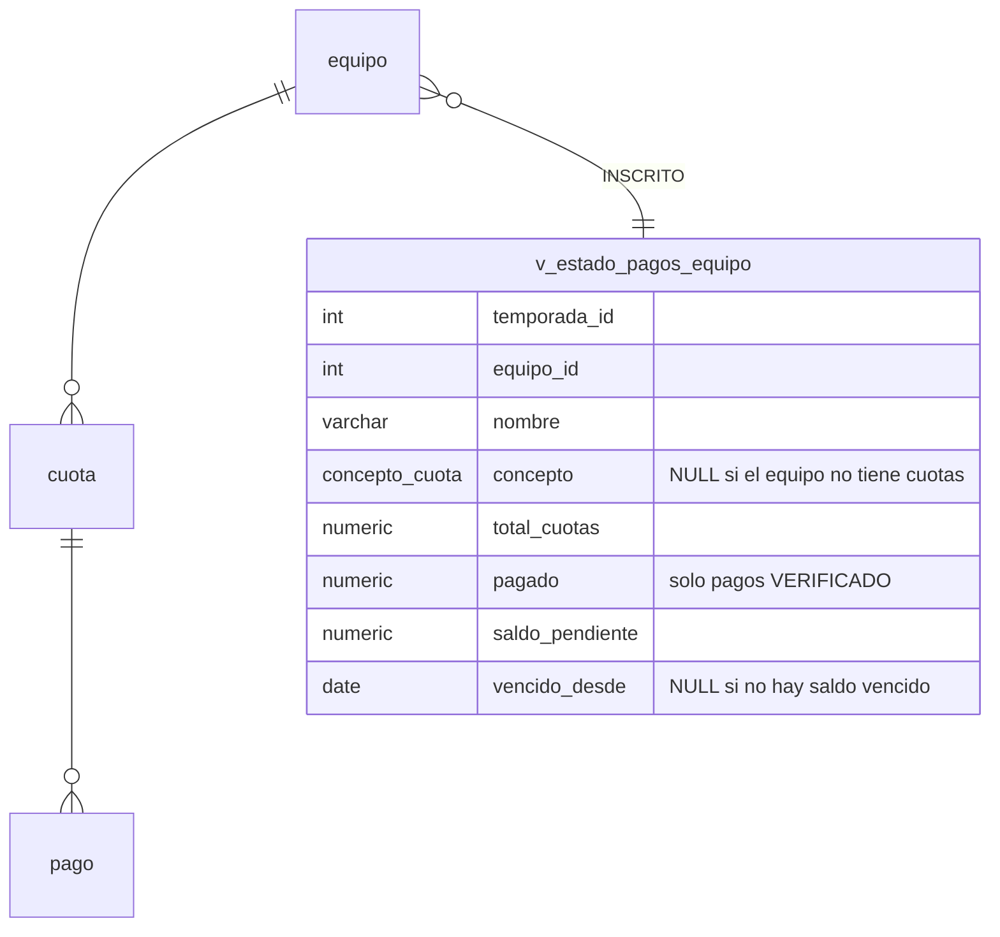

# H21 · Vista de saldos y vencimientos de cuotas por equipo (DB-21.1)

Migración: `20261113110000_db_21_1_vista_estado_pagos_equipo` (depende de DB-12.1, DB-13.1, DB-1.1, DB-2.1 y del índice de DB-14.1)

`v_estado_pagos_equipo`: vista de solo lectura sobre `equipo`, `cuota` y `pago`. Una fila por equipo **inscrito** y concepto. El reporte de pagos sale siempre de los registros del módulo 6; la vista no guarda nada.

## Columnas

| Columna | Cálculo |
|---|---|
| temporada_id, equipo_id, nombre | equipo |
| concepto | cuota (INSCRIPCION / ARBITRAJE); NULL en un equipo sin cuotas |
| total_cuotas | suma de `cuota.monto` del equipo y concepto |
| pagado | suma de pagos **VERIFICADO** |
| saldo_pendiente | `total_cuotas − pagado`, calculado por cuota (igual que `fn_saldo_cuota` de DB-13.1) |
| vencido_desde | `fecha_vencimiento` **más antigua** entre las cuotas que aún tienen saldo y ya vencieron |

## Reglas

- **Pagos PENDIENTE y RECHAZADO no cuentan como pagado:** no reducen el saldo. Un pago pendiente que luego se verifica sí lo reduce (la vista siempre refleja los pagos vigentes).
- **"Hoy" es la fecha de America/El_Salvador:** una cuota que vence hoy todavía no está vencida; la de ayer sí.
- `vencido_desde` es la cuota **más antigua con saldo**, no la más antigua en general: una cuota vencida y ya pagada no cuenta.
- Un equipo **sin cuotas** devuelve **una fila** con `concepto` nulo y montos en 0.
- Solo equipos con `estado = 'INSCRITO'` (valor definido en DB-2.1); los PENDIENTES y RECHAZADOS no aparecen.
- La vista tiene un JOIN con agregación, así que PostgreSQL no la hace actualizable: INSERT, UPDATE y DELETE fallan con SQLSTATE 55000 (las pruebas lo verifican).

## Para BE-21.1 (sugerencia de clasificación por equipo)

Un equipo con varios conceptos tiene varias filas; el estado se deriva sobre todas sus filas:
SIN_CUOTAS si `concepto` es nulo; MOROSO si alguna fila tiene `vencido_desde`; CON_SALDO si no y algún `saldo_pendiente > 0`; PAGADO en cualquier otro caso. Los totales del reporte son la suma de las filas devueltas.

## Notas

- La vista no está declarada en `schema.prisma`: se consulta con `prisma.$queryRaw` (igual que `v_tabla_posiciones`).
- La especificación pide que el rol de la aplicación tenga solo SELECT. El proyecto usa un único usuario de base de datos, así que no se crea un rol aparte; si se separa más adelante basta `GRANT SELECT ON v_estado_pagos_equipo TO <rol>`.
- Aprovecha `ix_cuota_equipo_temporada` (DB-14.1) para unir cuotas por equipo y temporada, y `ix_pago_cuota_estado` (DB-13.1) para los pagos.

## Reversión

`down.sql` hace `DROP VIEW`.
