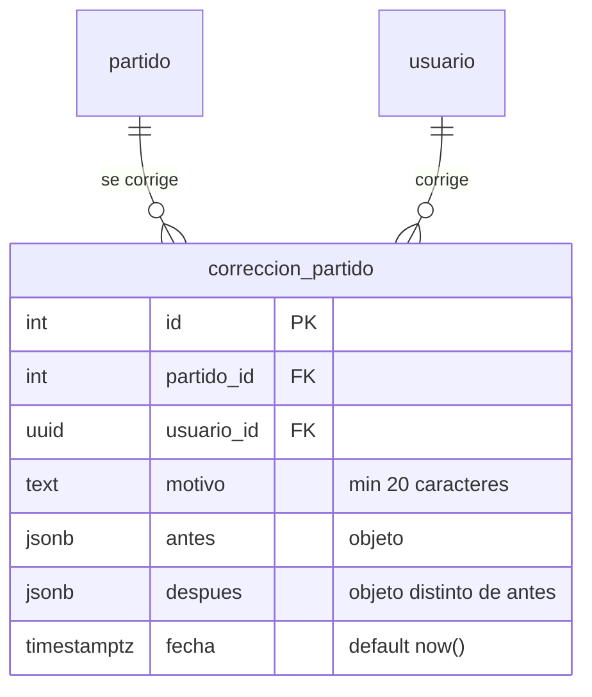

# H23 · Auditoría de correcciones de resultados (DB-23.1)

Migración: `20261112120000_db_23_1_correccion_partido` (depende de DB-5.1 y DB-9.1)

## Diccionario de datos

| Columna | Tipo | Nulo | Regla |
|---|---|---|---|
| id | SERIAL | no | PK |
| partido_id | INTEGER | no | FK partido, RESTRICT |
| usuario_id | UUID | no | FK usuario, RESTRICT (quien corrigió) |
| motivo | TEXT | no | `char_length(btrim(motivo)) >= 20` |
| antes | JSONB | no | objeto JSON |
| despues | JSONB | no | objeto JSON, distinto de `antes` |
| fecha | TIMESTAMPTZ(3) | no | default now() |

Índice `ix_correccion_partido (partido_id, fecha DESC)`: historial de un partido, lo más reciente primero.

## Cómo se usa

- BE-23.1 inserta la fila **dentro de la misma transacción** que aplica la corrección. Si esa transacción se revierte (ROLLBACK), la fila tampoco queda: la auditoría nunca describe algo que no ocurrió. Las pruebas lo verifican.
- Las instantáneas `antes` y `despues` incluyen el marcador y las estadísticas de los jugadores incluidos en la solicitud. Si se crea un registro nuevo, ese jugador aparece por primera vez en `despues`.

## API de corrección oficial (BE-23.1)

`GET /api/v1/partidos/{id}/correccion-oficial` devuelve un arreglo con el historial, desde la corrección más reciente. Cada entrada contiene `id`, `usuarioId`, `responsable`, `fecha`, `motivo`, `antes` y `despues`. Un partido sin correcciones devuelve `[]`. Ambas rutas requieren el rol `ORGANIZADOR`.

`PATCH /api/v1/partidos/{id}/correccion-oficial` recibe un `motivo` de 20 a 500 caracteres tras recortar espacios. Incluye `golesLocal` y `golesVisitante` juntos (de 0 a 99), un arreglo `estadisticas` con al menos un jugador, o ambos bloques. Cada fila de estadísticas indica `jugadorId`, `goles`, `asistencias` y `tarjetas`. Las tres cantidades son enteros no negativos. Los jugadores deben estar inscritos en un equipo del partido en esa temporada y cada uno puede aparecer una vez por solicitud.

La corrección mantiene el partido en `FINALIZADO`. El marcador, los cambios de estadísticas, la bitácora y las posiciones se confirman en la misma transacción. El `200` devuelve `partidoId`, `estado`, `correccionId`, `antes` y `despues`. Tras confirmar, H20 envía `RESULTADO_CORREGIDO` a ambos equipos con una clave por corrección. Si un envío falla, el servicio registra el fallo e intenta el envío al otro equipo.

- `400` para datos inválidos o una solicitud que repite los valores vigentes.
- `401` para una sesión inválida y `403` para otro rol.
- `404` si el partido no existe y `409` si su estado es incompatible con la corrección.
- `422` si un `jugadorId` no corresponde a una inscripción elegible.

### Pruebas de BE-23.1

Con las migraciones y el seed aplicados en una base PostgreSQL de pruebas, ejecuta `npm run test:e2e -- test/correccion-partido.e2e-spec.ts`. Los casos cubren el acceso, la validación, el marcador y las estadísticas, la auditoría, los avisos a ambos equipos, la concurrencia, la reversión ante un fallo de recálculo y la lectura actualizada en H6, H7, H10, H11 y H22.

El 19 de noviembre de 2026 pasaron 483 pruebas unitarias y 83 pruebas de integración del alcance en PostgreSQL 18. La ejecución final de la suite de corrección pasó sus 9 casos. La compilación y el análisis estático finalizaron correctamente. El análisis estático emitió dos advertencias preexistentes en las pruebas de seed.

## Solo inserción

La aplicación no edita ni borra filas de auditoría. El borrado físico solo ocurre al revertir la migración (`DROP TABLE`).

## Añadidos más allá de la especificación (se pueden quitar)

1. Trigger `tr_correccion_partido_inmutable`: rechaza UPDATE y DELETE sobre la tabla (SQLSTATE 23001), para que "no se edita ni se borra" lo garantice la base y no solo la aplicación. `TRUNCATE` y `DROP TABLE` (reversión, reinicio de la base) no pasan por él.
2. `ck_correccion_antes` / `ck_correccion_despues`: deben ser objetos JSON (no `null`, números ni listas).
3. `ck_correccion_cambia`: `antes <> despues` (una corrección que no cambia nada no se audita). JSONB compara por contenido, así que el orden de las llaves no importa.
4. `fecha` es `TIMESTAMPTZ(3)` (como el resto de las tablas del proyecto) en lugar del `TIMESTAMPTZ` de la especificación.

## Reversión

`down.sql` elimina trigger, función y tabla: es el único borrado físico previsto.
