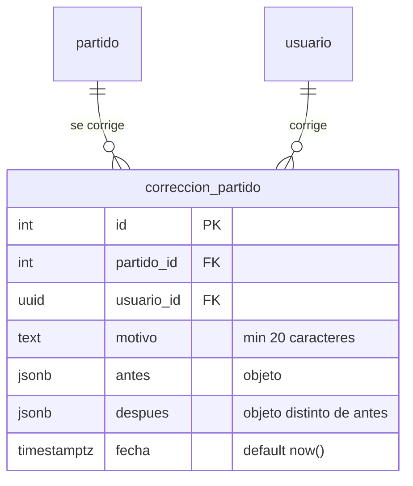

# H23 · Auditoría de correcciones de resultados (DB-23.1)

Migración: `20261112120000_db_23_1_correccion_partido` (depende de DB-5.1 y DB-9.1)

## Diccionario de datos

| Columna | Tipo | Nulo | Regla |
|---|---|---|---|
| id | SERIAL | no | PK |
| partido_id | INTEGER | no | FK partido, RESTRICT |
| usuario_id | UUID | no | FK usuario, RESTRICT (quien corrigió) |
| motivo | TEXT | no | `char_length(btrim(motivo)) >= 20` |
| antes | JSONB | no | objeto JSON |
| despues | JSONB | no | objeto JSON, distinto de `antes` |
| fecha | TIMESTAMPTZ(3) | no | default now() |

Índice `ix_correccion_partido (partido_id, fecha DESC)`: historial de un partido, lo más reciente primero.

## Cómo se usa

- BE-23.1 inserta la fila **dentro de la misma transacción** que aplica la corrección. Si esa transacción se revierte (ROLLBACK), la fila tampoco queda: la auditoría nunca describe algo que no ocurrió. Las pruebas lo verifican.
- Qué contienen `antes` y `despues` (por ejemplo `{"golesLocal":1,"golesVisitante":0}`) lo define el backend; la base solo exige que sean objetos y que difieran.

## Solo inserción

La aplicación no edita ni borra filas de auditoría. El borrado físico solo ocurre al revertir la migración (`DROP TABLE`).

## Añadidos más allá de la especificación (se pueden quitar)

1. Trigger `tr_correccion_partido_inmutable`: rechaza UPDATE y DELETE sobre la tabla (SQLSTATE 23001), para que "no se edita ni se borra" lo garantice la base y no solo la aplicación. `TRUNCATE` y `DROP TABLE` (reversión, reinicio de la base) no pasan por él.
2. `ck_correccion_antes` / `ck_correccion_despues`: deben ser objetos JSON (no `null`, números ni listas).
3. `ck_correccion_cambia`: `antes <> despues` (una corrección que no cambia nada no se audita). JSONB compara por contenido, así que el orden de las llaves no importa.
4. `fecha` es `TIMESTAMPTZ(3)` (como el resto de las tablas del proyecto) en lugar del `TIMESTAMPTZ` de la especificación.

## Reversión

`down.sql` elimina trigger, función y tabla: es el único borrado físico previsto.
