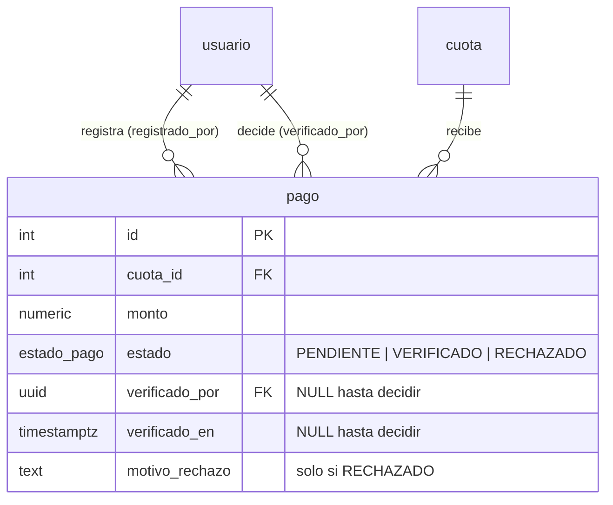

# H24 · Decisión de verificación de pagos (DB-24.1)

Migración: `20261112110000_db_24_1_decision_pago` (depende de DB-13.1)

## Qué agrega

No hay tabla nueva: la decisión vive en la misma fila de `pago`, así que no se duplica la persistencia de pagos.

## Diccionario de las columnas nuevas

| Columna | Tipo | Nulo | Regla |
|---|---|---|---|
| verificado_por | UUID | sí | FK a usuario, ON DELETE RESTRICT: no se borra un usuario que decidió un pago |
| verificado_en | TIMESTAMPTZ(3) | sí | momento de la decisión |
| motivo_rechazo | TEXT | sí | solo para RECHAZADO; mínimo 20 caracteres sin contar espacios de los extremos |

## Regla `ck_pago_decision`

| estado | verificado_por | verificado_en | motivo_rechazo |
|---|---|---|---|
| PENDIENTE | NULL | NULL | NULL |
| VERIFICADO | obligatorio | obligatorio | NULL |
| RECHAZADO | obligatorio | obligatorio | obligatorio, ≥ 20 caracteres tras `btrim` |

Consecuencia para quien escribe en `pago` (BE-13.1, BE-24.1): al resolver un pago hay que cambiar `estado` y llenar los campos de decisión en el **mismo UPDATE**; y volver a PENDIENTE exige dejar los tres en NULL.

## Cómo se evita la doble decisión

La base no impide por sí sola decidir dos veces, y no hace falta: BE-24.1 decide con `UPDATE pago SET ... WHERE id = ? AND estado = 'PENDIENTE'` y mira las filas afectadas (1 = decidió, 0 = "El pago ya fue resuelto", 409). Se probó con dos sesiones reales: la segunda espera a la primera, ve el pago ya resuelto y no cambia nada.

La cuota sigue siendo el punto de bloqueo compartido con DB-13.1: el trigger `tr_pago_no_supera_cuota` bloquea la fila de `cuota` en los UPDATE de `estado`, y las transiciones de H24 pasan por él.

## Efecto en los saldos

Sin cambios: `fn_saldo_cuota` ya trata los estados así. PENDIENTE reserva disponible; VERIFICADO baja el saldo; RECHAZADO libera lo reservado y no toca el saldo. El motivo queda en `pago.motivo_rechazo` para que H14 lo muestre.

## Añadido más allá de la especificación (se puede quitar)

- Índice parcial `ix_pago_pendientes (creado_en, id) WHERE estado = 'PENDIENTE'` para la bandeja de pendientes del organizador (los más antiguos primero); solo pesa lo que está sin resolver.
- Un bloque de guardia al inicio de la migración: si ya existen pagos VERIFICADO/RECHAZADO (no deberían, porque nada los resolvía antes de H24), la migración se detiene con un mensaje claro en lugar de fallar con un error de restricción. Los datos de DB-1.4 deben nacer ya con su decisión completa.

## Reversión

`down.sql` solo se puede ejecutar con éxito si todos los pagos están `PENDIENTE`. En una sola transacción, bloquea `pago` en modo `ACCESS EXCLUSIVE` antes de consultar los estados. Si encuentra un pago `VERIFICADO` o `RECHAZADO`, aborta con un error y conserva el esquema, los registros, las decisiones y los saldos.

Si todos los pagos están `PENDIENTE`, la transacción quita el índice parcial, la restricción `ck_pago_decision`, la llave foránea y las tres columnas de decisión. Los pagos y sus saldos se conservan y la migración se puede volver a aplicar.
