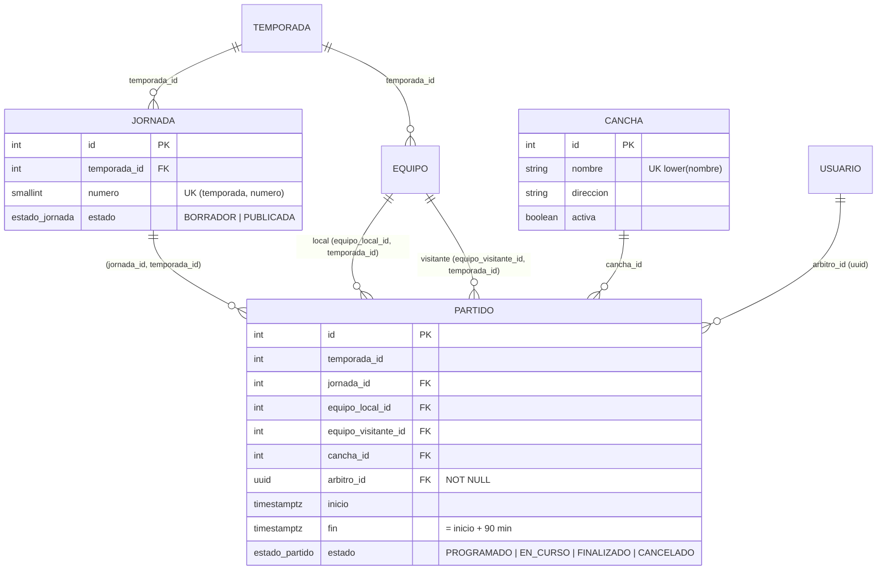

# Diagrama ER · H3 (cancha, jornada y partido)

Restricciones del partido (todas en la base de datos):

| Regla | Mecanismo |
|---|---|
| Una cancha no tiene dos partidos traslapados | `EXCLUDE USING gist (cancha_id WITH =, tstzrange(inicio, fin) WITH &&) WHERE (estado <> 'CANCELADO')` |
| Un árbitro no tiene dos partidos traslapados | Igual, sobre `arbitro_id` |
| Un cruce A–B ocurre una sola vez por temporada (solo ida) | Índice único parcial sobre `(temporada_id, LEAST(local, visitante), GREATEST(local, visitante))` |
| Duración de 90 minutos; equipos distintos | `CHECK` |
| Equipos y jornada pertenecen a la temporada del partido | Llaves foráneas compuestas |
| Un Cancelado libera cancha, árbitro y cruce | Las restricciones excluyen `estado = 'CANCELADO'` |
| Dos partidos consecutivos (09:30 y 09:30) son válidos | `tstzrange` es semiabierto `[inicio, fin)` |

Se validan en el backend, no en la base: que `arbitro_id` tenga rol Árbitro, que ambos equipos estén Inscritos y "un partido por semana por equipo".

## Decisión (regla 2.2): por qué las restricciones de choque viven en la base de datos

Con dos organizadores agendando a la vez, una validación solo en el backend tiene una ventana de carrera: ambos consultan, ambos ven la cancha libre y ambos insertan. Solo la base de datos puede decidir de forma atómica cuál de los dos gana, así que ningún error o simultaneidad del backend puede generar un calendario inválido. El backend traduce los códigos de PostgreSQL (`23P01` exclusión, `23505` único) a respuestas 409. Alternativa descartada: validar solo en backend. Prisma no expresa las exclusiones ni los índices con expresión; por eso la migración se escribe a mano en SQL y se verifica con `prisma migrate dev` que no haya desviación.
