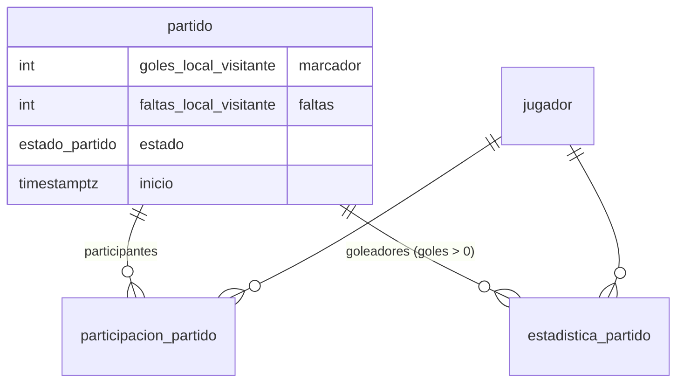

# H6 · Índices y consultas del marcador (DB-6.1)

Migración: `20261112130000_db_6_1_indice_partido_estado` (depende de DB-3.1, DB-5.1 y DB-9.1)

No se crean tablas: el detalle del marcador sale de tres fuentes que ya existen.



## Índice agregado

`ix_partido_estado_inicio` sobre `partido (estado, inicio DESC)`: sirve a la lista (`GET /api/v1/partidos?estado=...`), que filtra por estado y ordena por inicio descendente. Con filtro por equipo se siguen usando `ix_partido_local_inicio` e `ix_partido_visitante_inicio` (DB-4.1).

Limitación conocida: sin filtro de estado (la lista completa) el índice no ayuda al orden; la consulta ordena la página con un top-N, que con `LIMIT` es barato.

## Índice que NO se creó: `ix_participacion_partido (partido_id)`

La especificación lo menciona, pero `participacion_partido` ya tiene como llave primaria `(partido_id, jugador_id)`, y PostgreSQL usa esa llave para cualquier búsqueda por `partido_id`. Un índice extra solo duplicaría ese recorrido y encarecería cada escritura. Las pruebas verifican que la llave primaria cubre `partido_id`. Si el equipo prefiere crearlo de todos modos, es una línea.

## Consultas (parametrizadas, para `$queryRaw`)

Lista (`$1` estado o NULL, `$2` equipoId o NULL, `$3` true si el token es de organizador, `$4` pageSize, `$5` offset):

```sql
SELECT p.id, j.numero AS jornada, p.inicio, p.estado,
       p.equipo_local_id, el.nombre AS local_nombre,
       CASE WHEN p.estado = 'PROGRAMADO' THEN NULL ELSE p.goles_local END AS goles_local,
       p.equipo_visitante_id, ev.nombre AS visitante_nombre,
       CASE WHEN p.estado = 'PROGRAMADO' THEN NULL ELSE p.goles_visitante END AS goles_visitante
FROM partido p
JOIN jornada j  ON j.id  = p.jornada_id
JOIN equipo  el ON el.id = p.equipo_local_id
JOIN equipo  ev ON ev.id = p.equipo_visitante_id
WHERE p.estado <> 'CANCELADO'
  AND ($1::estado_partido IS NULL OR p.estado = $1::estado_partido)
  AND ($2::int IS NULL OR p.equipo_local_id = $2 OR p.equipo_visitante_id = $2)
  AND ($3::boolean OR j.estado = 'PUBLICADA')
ORDER BY p.inicio DESC, p.id DESC
LIMIT $4 OFFSET $5;
```

El `total` de la paginación es el mismo `FROM ... WHERE` con `SELECT count(*)`. Se agrega `p.id DESC` como desempate para que la paginación sea estable cuando dos partidos comparten inicio.

Detalle, participantes (`$1` partido):

```sql
SELECT pp.equipo_id, j.id AS jugador_id, j.nombre_completo
FROM participacion_partido pp JOIN jugador j ON j.id = pp.jugador_id
WHERE pp.partido_id = $1
ORDER BY pp.equipo_id, j.nombre_completo, j.id;
```

Detalle, goleadores (no duplica filas: `(partido_id, jugador_id)` es único y `(temporada_id, jugador_id)` en `equipo_jugador` también):

```sql
SELECT ej.equipo_id, j.id AS jugador_id, j.nombre_completo, e.goles
FROM estadistica_partido e
JOIN jugador j  ON j.id = e.jugador_id
JOIN partido pt ON pt.id = e.partido_id
JOIN equipo_jugador ej ON ej.jugador_id = e.jugador_id AND ej.temporada_id = pt.temporada_id
WHERE e.partido_id = $1 AND e.goles > 0
ORDER BY e.goles DESC, j.nombre_completo, j.id;
```

Marcador y faltas salen de la fila de `partido` (`goles_*`, `faltas_*`).

## EXPLAIN de la lista

La tabla real solo tiene 66 filas y PostgreSQL prefiere leerla completa (correcto con tan pocas). Para ver el índice con volumen se usa en las pruebas una copia temporal de ~20 mil partidos con el mismo índice. Resultado para `estado = 'EN_CURSO'`, página de 20:

```
Limit (actual rows=20 loops=1)
  ->  Incremental Sort (actual rows=20 loops=1)
        Sort Key: inicio DESC, id DESC
        ->  Index Scan using ix_escala_estado_inicio on partido_escala (actual rows=21 loops=1)
              Index Cond: (estado = 'EN_CURSO'::estado_partido)
```

Usa el índice por estado y lee 21 filas para devolver 20. El `Incremental Sort` es solo el desempate `id DESC` sobre esas pocas filas. Lo mismo ocurre con `PROGRAMADO` (el estado más común) y `FINALIZADO`.

## Reversión

`down.sql` elimina el índice.
