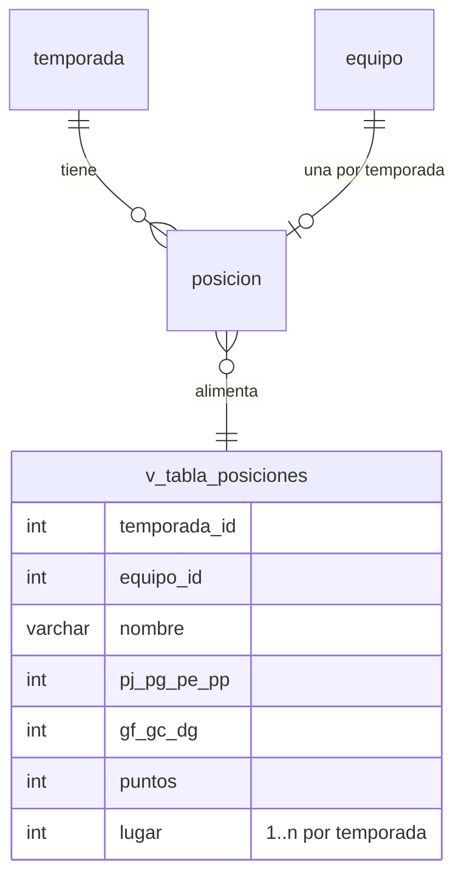

# H7 · Vista de la tabla de posiciones (DB-7.1)

Migración: `20261112100000_db_7_1_vista_tabla_posiciones` (depende de DB-8.1)

## Qué es

`v_tabla_posiciones`: vista de solo lectura sobre `posicion` + `equipo` + `temporada`. Devuelve solo la temporada con `temporada.actual = TRUE` y calcula el `lugar` de cada equipo.

## Columnas

| Columna | Origen |
|---|---|
| temporada_id, equipo_id | posicion |
| nombre | equipo.nombre |
| pj, pg, pe, pp, gf, gc, dg, puntos | posicion |
| lugar | ROW_NUMBER() (INTEGER) |

## Orden del lugar (H7)

1. `puntos` descendente
2. `dg` descendente
3. `gf` descendente
4. `nombre` ascendente
5. `equipo.id` ascendente (agregado como último desempate para que el orden sea siempre determinista)

## Solo lectura

La vista contiene un JOIN y una función de ventana, por lo que PostgreSQL no la hace actualizable: INSERT, UPDATE y DELETE fallan con SQLSTATE 55000. Las pruebas lo verifican. Las escrituras se hacen solo sobre `posicion` (BE-8.1).

## Notas para el backend

- La vista **solo muestra equipos que tienen fila en `posicion`**. Si un equipo inscrito aún no tiene fila, no aparece; BE-8.1 debe crear la fila (en ceros) al inscribirlo o al recalcular.
- `lugar` es INTEGER (no BIGINT) para que `$queryRaw` no devuelva `BigInt` y falle al serializar a JSON.
- La vista no está declarada en `schema.prisma`: se consulta con `prisma.$queryRaw`.
- La especificación pide que el rol de la aplicación tenga solo SELECT. El proyecto usa un único usuario de base de datos, así que no se crea un rol aparte; si se separa más adelante, basta un `GRANT SELECT ON v_tabla_posiciones TO <rol>`.

## Reversión

`down.sql` hace `DROP VIEW`. Si se revierte DB-8.1 (que elimina `posicion`), esta migración debe revertirse primero.
