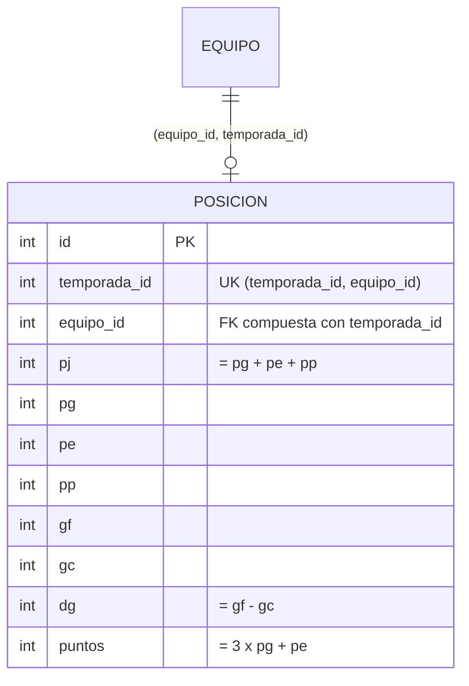

# Diagrama ER · H8 (tabla posicion)

Una fila por equipo y temporada. La escribe solo el backend (`PosicionesService.recalcular`, BE-8.1) desde los partidos Finalizados; no hay edición manual.

## Restricciones

| Regla | Mecanismo | Error |
|---|---|---|
| Un equipo aparece una vez por temporada | `UNIQUE (temporada_id, equipo_id)` | 23505 |
| Solo equipos y temporadas existentes, y el equipo pertenece a esa temporada | FK compuesta `(equipo_id, temporada_id)` a `equipo(id, temporada_id)` | 23503 |
| Valores no negativos (pj, pg, pe, pp, gf, gc, puntos) | `CHECK` | 23514 |
| `pj = pg + pe + pp` | `CHECK` | 23514 |
| `dg = gf - gc` | `CHECK` (adición) | 23514 |
| `puntos = pg × 3 + pe` | `CHECK` (adición) | 23514 |

`dg` puede ser negativo. No se puede borrar un equipo que tenga posición.

## Decisiones que van más allá del texto de la tarea

- **FK compuesta** en lugar de dos llaves simples: además de que existan el equipo y la temporada, impide poner un equipo en una temporada que no es la suya (mismo criterio que `partido`).
- **`ck_posicion_dg` y `ck_posicion_puntos`** reproducen las fórmulas de H8 y de BE-8.1. Como esa tabla no se edita a mano, una fila incoherente solo puede venir de un error de cálculo, y así la base lo rechaza. Si se quisieran quitar, son dos líneas de la migración.

## Datos de prueba

Las filas de `posicion` las calcula BE-8.1 sobre los partidos Finalizados que carga DB-1.4; esta migración no inserta filas.
