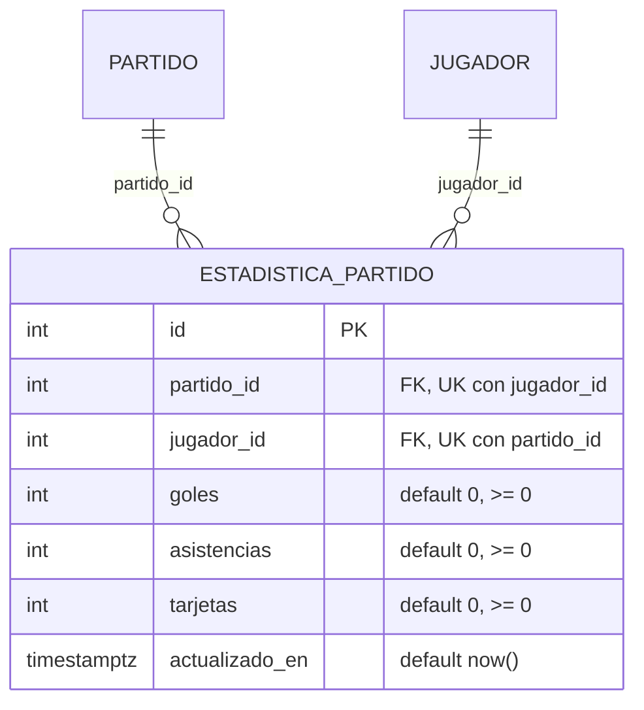

# Diccionario de datos y ER · H9 (estadistica_partido)



## Contrato común (H6, H9, H10, H11, H22)

`estadistica_partido` es la **única** fuente de goles, asistencias y tarjetas por jugador. Los nombres lógicos de DB-10.1 corresponden a tablas que ya existen, no a tablas nuevas:

| Nombre lógico | Tabla física |
|---|---|
| `estadistica_jugador` | `estadistica_partido` |
| `inscripcion_jugador` | `equipo_jugador` |
| `es_oficial` / `resultadoOficial` | derivado de `partido.estado = 'FINALIZADO'`; no hay columna `resultado_oficial` |
| temporada de la estadística | `partido.temporada_id`; no se repite en esta tabla |

El marcador por equipo y las faltas viven en `partido` (DB-5.1), no aquí.

## Consulta compartida

```sql
SELECT e.partido_id, e.jugador_id, e.goles, e.asistencias, e.tarjetas,
       p.temporada_id, p.estado, (p.estado = 'FINALIZADO') AS es_oficial
FROM estadistica_partido e
JOIN partido p ON p.id = e.partido_id;
```

Goleadores oficiales de una temporada (solo partidos Finalizados):

```sql
SELECT e.jugador_id, sum(e.goles) AS goles
FROM estadistica_partido e JOIN partido p ON p.id = e.partido_id
WHERE p.temporada_id = :temporada AND p.estado = 'FINALIZADO'
GROUP BY e.jugador_id ORDER BY goles DESC;
```

## Restricciones

| Regla | Mecanismo | Error |
|---|---|---|
| Un registro por jugador y partido | `UNIQUE (partido_id, jugador_id)` | 23505 |
| Goles, asistencias y tarjetas >= 0 | `CHECK` por columna | 23514 |
| Partido y jugador existentes | FK `RESTRICT` (INTEGER) | 23503 |
| No se borra un partido ni un jugador con estadísticas | FK `RESTRICT` | 23503 / 23001 |
| El jugador está inscrito en uno de los dos equipos del partido, en la temporada del partido | trigger `tr_estadistica_jugador_del_partido` | 23514 |

`actualizado_en` lo pone la base al crear; al actualizar lo mantiene Prisma (`@updatedAt`). Un `UPDATE` en SQL directo debe fijarlo a mano.

## Decisión que va más allá del texto de la tarea

El **trigger** repite la validación de BE-9.1 ("inscrito en equipo_jugador en esa temporada y en uno de los equipos participantes"). Sin él, las llaves foráneas permiten registrar goles a un jugador de un equipo que no juega el partido, y esos goles alimentarían H6, H10, H11 y H22. Si se prefiere dejar la regla solo en el backend, basta quitar el bloque de la migración.

## Dato de prueba

`npm run db:seed` carga una fila: el 12.º partido de Apertura 2026, un jugador inscrito en su equipo local, con goles 1, asistencias 0 y tarjetas 1 (se reutilizan los ids reales del seed). DB-1.4 cargará las estadísticas de los partidos Finalizados.
